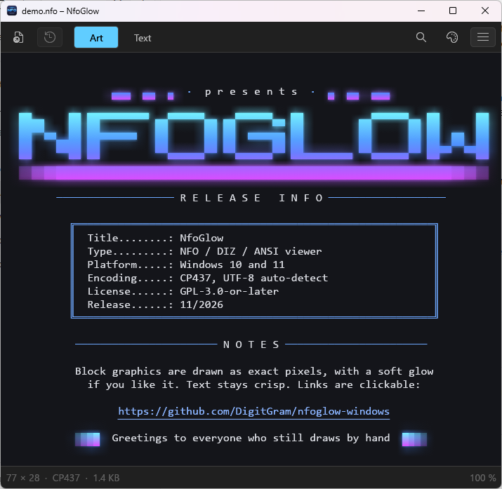
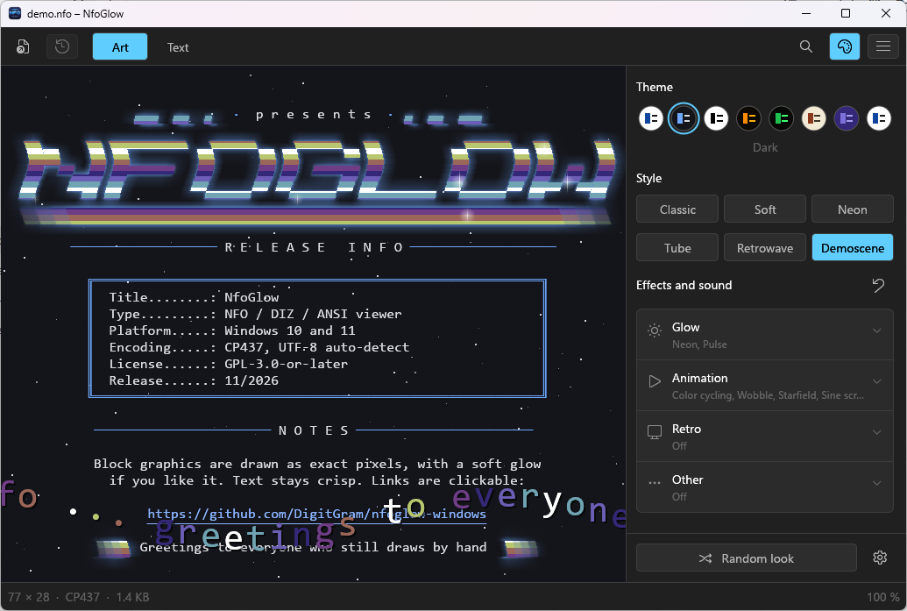
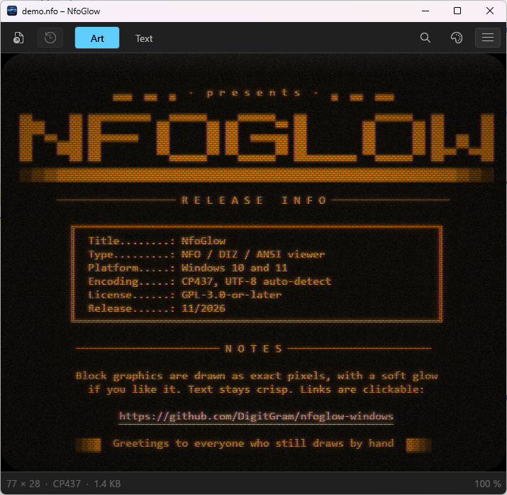

<p align="center">
  
</p>

<h1 align="center">NfoGlow for Windows</h1>

<p align="center">
  <b>NFO and ANSI art, the way the scene meant it.</b> A viewer for <code>.nfo</code>, <code>.diz</code> and <code>.ans</code> files<br>
  on Windows 10 and 11, with exact pixels, glow, animations, effects and chiptunes. Installs for your user, no administrator needed.
</p>

<p align="center">
  <a href="https://github.com/DigitGram/nfoglow-windows/actions/workflows/windows.yml"></a>
  <a href="LICENSE"></a>
  <a href="https://github.com/DigitGram/nfoglow-windows/releases/latest"></a>
</p>

<p align="center">
  <a href="#install"><b>Install</b></a> ·
  <a href="#keyboard">Keyboard</a> ·
  <a href="#verify-the-download">Verify the download</a> ·
  <a href="https://github.com/DigitGram/nfoglow">NfoGlow for Linux</a> ·
  <a href="https://digitgram.github.io/nfoglow/">Website</a> ·
  <a href="#support">Support</a>
</p>

<p align="center">
  
</p>

This is the official Windows port of [NfoGlow](https://github.com/DigitGram/nfoglow), rewritten in Rust. It shows an NFO
the same way as NfoGlow for Linux, with the same effects, themes and options, and reads the same look codes; only the
window follows the style of Windows 11.

Inspired by the Windows classic [iNFekt](https://github.com/syndicodefront/infekt).

Most text viewers draw the block characters `█ ▀ ▄ ░ ▒ ▓` with a font, which leaves gaps and seams in the art.
NfoGlow paints them as exact pixels, optionally with a soft glow, and keeps the text crisp.

## Contents

- [What you get](#what-you-get)
- [Requirements](#requirements)
- [Install](#install)
- [Verify the download](#verify-the-download)
- [Privacy](#privacy)
- [Keyboard](#keyboard)
- [Command line](#command-line)
- [Differences from NfoGlow for Linux](#differences-from-nfoglow-for-linux)
- [Translating](#translating)
- [Development](#development)
- [How it was made](#how-it-was-made)
- [Support](#support)
- [License](#license)

## What you get

- **Clean art.** Block graphics as exact pixels, without seams.
- **Smooth edges, for the pixel haters.** One switch turns the steps of the block art into straight diagonals and round curves, anti-aliased, and lets the ░▒▓ shading fade softly. Off by default, because some of us like our pixels.
- **Effects (F9).** Neon glow, phosphor glow, colour ramps, scanlines, shadow mask and aperture grille, colour fringe, a live CRT and the IBM VGA font. The window grows by the sidebar instead of covering the NFO.
- **Styles.** Classic, Soft, Neon, Tube, Retrowave and Demoscene set everything with one click; every effect can still be tuned on its own.
- **Demoscene mode.** Colour cycling, wobbling logo, stars, sine scroller, sparkles and a glow that pulses to the music, plus one of eight opening effects (modem build-up, C64 loader, DOS boot, CRT power-on, code rain and more). Off by default.
- **Random look.** Roll a new combination with one click, keep it or get a fresh one at every start. Ctrl+Z undoes any change.
- **Music.** Nine built-in chiptunes by Stennish, or your own folder of MOD, XM, S3M, IT, OGG, MP3, FLAC and WAV (e.g. from [The Mod Archive](https://modarchive.org)). Off by default.
- **Reads old NFOs right.** CP437 out of the box, broken UTF-8 repaired, CP850 and Latin-1 on request. ANSI art in 16, 256 and true colour, SAUCE included.
- **Handy.** Open straight from a ZIP or ReScene `.srr`, browse a release folder with ← and →, reload on file change, search (Ctrl+F), clickable links, zoom, text-only view (Ctrl+T) and copying without the art.
- **Themes.** Light, Dark, Black & White, Amber, Terminal, Paper, C64 and Custom, with Consolas, Cascadia, Lucida Console, Courier New or JetBrains Mono. The first start follows the light or dark mode of Windows.
- **Share your look.** Copy look puts one line of text on the clipboard, Paste look applies it, also between Windows and Linux. No paths or file lists are shared.
- **Save as PNG or PDF** (Ctrl+S), also from the command line.
- **Windows look.** In the style of Windows 11, in ten languages, the same as NfoGlow for Linux.

<p align="center">
  
  
  
</p>

<p align="center"><sub>More screenshots on the <a href="https://digitgram.github.io/nfoglow/#gallery">project website</a>.</sub></p>

## Requirements

- Windows 10 or 11, 64-bit. Nothing else needs to be installed.
- A graphics driver with DirectX 12 or Vulkan, which the PCs of the last ten years have. The window is drawn by the
  graphics card; it was tested on an Intel HD 4400 from 2013, a weak one.
- Optional, for music: a sound device. Without one NfoGlow works, just without music.

## Install

Windows 10 or 11, 64-bit.

1. Download `NfoGlow-Setup-1.0.0.exe` from the [latest release](https://github.com/DigitGram/nfoglow-windows/releases/latest).
2. Run it. Choose **Only for me** (no administrator needed) or **For all users** (Program Files, asks for administrator
   rights). Opening `.nfo .diz .ans .asc .srr` files with NfoGlow is on by default, a desktop shortcut is off.

**The setup is not signed yet.** Windows SmartScreen may warn about an unknown publisher: click **More info**, then
**Run anyway**. You can check that the file is the one built here, see [Verify the download](#verify-the-download).

Installing a newer release over an existing one keeps your settings. If NfoGlow is running, the setup asks you to close
it first.

Silent install, for example for a script: `NfoGlow-Setup-1.0.0.exe /S /CurrentUser` (or `/AllUsers` from an
administrator prompt).

**Uninstall** in Settings → Apps → Installed apps → NfoGlow. It asks whether to delete your settings too (No is the
default); they are in `%APPDATA%\NfoGlow`.

## Verify the download

Every release is built by [GitHub Actions](https://github.com/DigitGram/nfoglow-windows/actions/workflows/windows.yml)
from the tagged commit; the log of that run is public. It attaches the setup, `nfoglow.exe` and `SHA256SUMS.txt`, the
checksums of both. The checksums are signed with the key of `digitgram@proton.me`, fingerprint
`E7AA EB31 A4DE CF99 B314 7E1D FAAB 30B5 FD49 0E93`: the file `SHA256SUMS.txt.asc` is attached to the release.

To check the checksum of your download, in PowerShell, in your Downloads folder:

```powershell
Get-FileHash .\NfoGlow-Setup-1.0.0.exe -Algorithm SHA256
```

The hash must be the same as the line for `NfoGlow-Setup-1.0.0.exe` in `SHA256SUMS.txt`.

To check that `SHA256SUMS.txt` is from the author (needs [Gpg4win](https://www.gpg4win.org/) or another GnuPG):

```powershell
curl.exe -fsSLO https://github.com/DigitGram.gpg
gpg --import DigitGram.gpg
curl.exe -fsSLO https://github.com/DigitGram/nfoglow-windows/releases/latest/download/SHA256SUMS.txt
curl.exe -fsSLO https://github.com/DigitGram/nfoglow-windows/releases/latest/download/SHA256SUMS.txt.asc
gpg --verify SHA256SUMS.txt.asc SHA256SUMS.txt
```

Trust the checksums only if gpg reports a good signature and the fingerprint matches the one above.

## Privacy

NfoGlow makes no network connections of its own. A click on a link in an NFO hands it to your web browser. The list of
**recent files** is kept only in your settings file (`%APPDATA%\NfoGlow\settings.json`) on your computer. Turn it off
under Settings → General → Remember recent files; that also clears the list.

## Keyboard

| Keys | Action |
| --- | --- |
| Ctrl+O | Open |
| ← → | Previous, next NFO in the folder |
| Space, Shift+Space | Page down, up |
| F5, Ctrl+R | Reload |
| Ctrl+F, Enter, Shift+Enter | Search, next, previous match |
| Ctrl+T | Art or text only |
| F9 | Effects sidebar |
| Ctrl+Z | Undo the last change to the look |
| Ctrl+M | Music on or off |
| Ctrl+C, Ctrl+A | Copy (the selection, or everything), select all |
| Ctrl+Plus, Ctrl+Minus, Ctrl+0 | Zoom in, out, back to the default zoom |
| Ctrl+S | Save as PNG |
| Ctrl+, | Preferences |
| Ctrl+? | All keyboard shortcuts |
| Ctrl+W, Ctrl+Q | Close the window, quit |

## Command line

```
nfoglow FILE                        open a file
nfoglow --export FILE OUT.png       save FILE as an image, in the look of your settings, without a window
nfoglow --export FILE OUT.pdf       or as a PDF
```

`nfoglow.exe` is in the folder you installed to (for "Only for me": `%LOCALAPPDATA%\Programs\NfoGlow`).

Exporting needs no window, so it works in a script. In the window, a page too long for a PNG (over 32767 pixels) is
refused with a hint to save a PDF instead.

## Differences from NfoGlow for Linux

- The text in a PDF cannot be selected; the page is one picture.
- Music: no `.mptm` and `.opus` files.
- The settings are not shared: each app keeps its own. A look code moves a look from one to the other.

## Translating

The translations are the `.po` files of NfoGlow for Linux, copied into `po/` and built into the program. German is
maintained by the author; all other languages were generated by an AI assistant and have not been reviewed by native
speakers. Please send corrections to [NfoGlow for Linux](https://github.com/DigitGram/nfoglow/issues/new/choose) (the
"Translation fix" form); both apps get them from there.

## Development

Building, the tests, the setup and the project layout: [docs/development.md](docs/development.md).

## How it was made

NfoGlow is developed and maintained by DigitGram. The project is shaped by its requirements, design decisions and ongoing development.

AI-assisted tools were used during implementation and to support code quality improvements, testing, hardening and translations. All changes are reviewed and tested by the author, who is responsible for the final result.

The code is open, the tests are in `src/` (`cargo test`), and issues and pull requests are welcome.

## Support

NfoGlow is free and stays free. If it is useful to you, you can support its development on [GitHub Sponsors](https://github.com/sponsors/DigitGram) or [Liberapay](https://liberapay.com/DigitGram). Donations are voluntary and unlock nothing.

## License

Copyright (C) 2026 DigitGram. NfoGlow is free software: you can redistribute it and/or modify it under the terms of the
[GNU General Public License](LICENSE) as published by the Free Software Foundation, either version 3 of the License, or
(at your option) any later version. It comes without any warranty. The icon is part of the project and under the same
license; the music and the font below are not. Inspired by iNFekt by syndicode.

The built-in music is by **Stennish** ([chiptunes](https://soundcloud.com/autistgamer1337/sets/chiptunes)),
licensed under [CC BY 4.0](https://creativecommons.org/licenses/by/4.0/); see [assets/music](assets/music/README.md)
for the tracks and what was changed. Thank you, Stennish!

The DOS font is PxPlus IBM VGA 8x16 from [The Ultimate Oldschool PC Font Pack](https://int10h.org/oldschool-pc-fonts/)
by **VileR**, licensed under [CC BY-SA 4.0](https://creativecommons.org/licenses/by-sa/4.0/) and included unchanged;
see [assets](assets/font-README.md). Thank you, VileR!

Tracker modules are played with [xmrsplayer](https://codeberg.org/sbechet/xmrsplayer) (MIT). The licenses of all
libraries in the program are in [THIRD-PARTY-LICENSES.txt](THIRD-PARTY-LICENSES.txt), which the setup also installs.
